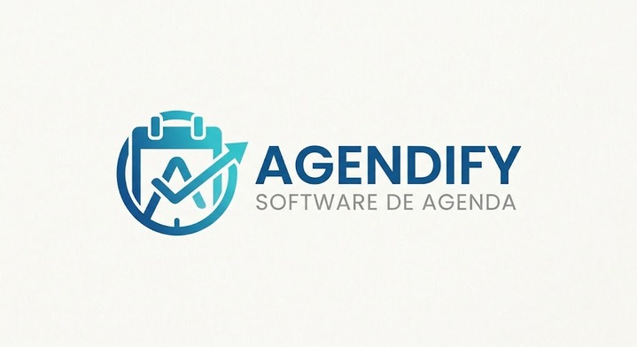

# Agendify - Software de Agenda

> Aplicativo cross-platform de gestão de agenda, eventos e tarefas, desenvolvido em Flutter com Firebase como backend. Resolve o problema de quem organiza compromissos e pendências em ferramentas separadas, reunindo tudo em um só lugar, acessível pelo navegador e pelo celular.



## Capturas de tela

<!-- Substituir pelas capturas reais, salvas em assets/screenshots/ -->
| Login | Dashboard | Agenda | Tarefas |
|:---:|:---:|:---:|:---:|
|  |  |  |  |

Versão publicada: https://agendify-ae460.web.app

---

## Tecnologias Utilizadas

As versões são as restrições declaradas no `pubspec.yaml` (`^` = aquela versão ou superior compatível).

| Tecnologia          | Versão              | Função                               |
|---------------------|---------------------|--------------------------------------|
| Flutter             | 3.27 ou superior (stable) | Framework UI cross-platform    |
| Dart                | `>=3.3.0 <4.0.0`    | Linguagem de programação             |
| firebase_core       | `^4.15.0`           | Inicialização do Firebase            |
| firebase_auth       | `^6.7.0`            | Autenticação por e-mail e senha      |
| cloud_firestore     | `^6.10.0`           | Banco de dados em nuvem              |
| provider            | `^6.1.2`            | Gerenciamento de estado              |
| table_calendar      | `^3.1.2`            | Componente de calendário             |
| shared_preferences  | `^2.2.3`            | Sessão de login salva no dispositivo |
| intl                | `^0.19.0`           | Formatação de datas (prevista)       |
| uuid                | `^4.4.0`            | Geração de IDs únicos                |

O papel de cada biblioteca na arquitetura está detalhado em [docs/02-arquitetura.md](docs/02-arquitetura.md#6-papel-das-bibliotecas).

---

## Como Rodar do Zero

### 1. Pré-requisitos

- [Git](https://git-scm.com/)
- [Flutter SDK](https://docs.flutter.dev/get-started/install) **3.27 ou superior**, no PATH (já inclui o Dart)
- Google Chrome (para rodar na Web)

Confira a instalação:

```bash
flutter --version
flutter doctor
```

### 2. Clonar o repositório

```bash
git clone https://github.com/Leptospirose-Aguda/agendify.git
cd agendify
```

### 3. Instalar as dependências

```bash
flutter pub get
```

### 4. Variáveis de ambiente

Não é preciso criar `.env` para rodar: a configuração do Firebase já está em `lib/firebase_options.dart`. O arquivo [.env.example](.env.example) serve só como referência dos valores do projeto Firebase, caso alguém queira apontar o app para outro projeto.

### 5. Rodar no navegador

```bash
flutter run -d chrome --web-port 8080
```

O app abre no Chrome, na tela de login. Na primeira vez, toque em **"Não tenho conta — Criar conta"**, informe um e-mail e uma senha de pelo menos 6 caracteres e entre.

### Problemas comuns

- *Erro de compilação no tema (`CardThemeData`)*: o Flutter está abaixo da 3.27. Rode `flutter upgrade`.
- *Porta 8080 ocupada*: troque por outra, por exemplo `--web-port 5000`.

---

## Para a equipe (requer acesso ao projeto Firebase)

Estes passos não fazem parte do "rodar do zero": exigem permissão no projeto `agendify-ae460` ou configuração extra.

**Deploy no Firebase Hosting** (precisa do [Firebase CLI](https://firebase.google.com/docs/cli) e de login numa conta com acesso ao projeto):

```bash
flutter build web --release
firebase deploy --only hosting --project agendify-ae460
```

**Gerar APK Android** (o repositório não versiona a pasta `android/`, então ela precisa ser gerada antes):

```bash
flutter create . --platforms=android
flutter build apk
```

---

## Estrutura do Projeto

```text
agendify/
├── README.md
├── LICENSE
├── .env.example
├── docs/                      # documentação (ordem de leitura)
├── lib/
│   ├── main.dart              # inicializa Firebase e Providers
│   ├── app.dart               # MaterialApp, tema e rotas
│   ├── firebase_options.dart  # configuração do projeto Firebase
│   ├── core/                  # providers, rotas, tema, cores, widgets
│   ├── features/              # telas: auth, home, calendar, events, tasks, search, settings, profile
│   ├── models/                # EventModel, TaskModel, CategoryModel
│   └── services/              # acesso ao Firestore
├── assets/
├── web/                       # configuração da versão Web
├── windows/                   # configuração da versão Windows
├── backend/                   # legado: API Shelf + SQLite da versão 0.x, não usada pelo app atual
├── firebase.json              # Firebase Hosting
└── pubspec.yaml
```

---

## Documentação

1. [Visão e requisitos](docs/01-visao-e-requisitos.md): problema, público, requisitos funcionais e não funcionais, critérios de aceitação e escopo.
2. [Arquitetura](docs/02-arquitetura.md): camadas, mapa de navegação, diagramas de sequência, dados no Firestore e papel das bibliotecas.
3. [Planejamento](docs/03-planejamento.md): cronograma, estratégia de branches, convenção de commits e licença.

Contexto técnico complementar: [CONTEXTO.md](CONTEXTO.md).

---

## Contribuindo

Fluxo de trabalho (GitHub Flow), detalhado em [docs/03-planejamento.md](docs/03-planejamento.md#2-estratégia-de-branches):

1. Crie uma branch a partir da `main`: `git checkout -b feature/nome`
2. Faça commits no padrão Conventional Commits: `feat: descrição da mudança`
3. Abra um Pull Request no GitHub
4. Após aprovação, faça o merge na `main`

---

## Autores

<!-- Completar com todos os integrantes do grupo -->
- Bruno Moura Mathias Fernandes Simão ([@brunomouramathias](https://github.com/brunomouramathias))
- Gabriel Tadeu Costa Sanmartin ([@GTCSanmar](https://github.com/GTCSanmar))
- Luna Ribeiro Alves dos Santos ([@LunaRibeiro](https://github.com/LunaRibeiro))
- Rafael Tomkowski ([@Rafael-Tomkowski ](https://github.com/Rafael-Tomkowski))
- Rocque dos Reis Pennafort ([@Rocque-Pennafort](https://github.com/Rocque-Pennafort))


COM1045 · UTFPR Medianeira · Ciência da Computação

## Licença

Distribuído sob a licença MIT. Veja o arquivo [LICENSE](LICENSE). A justificativa da escolha está em [docs/03-planejamento.md](docs/03-planejamento.md#5-licença).
