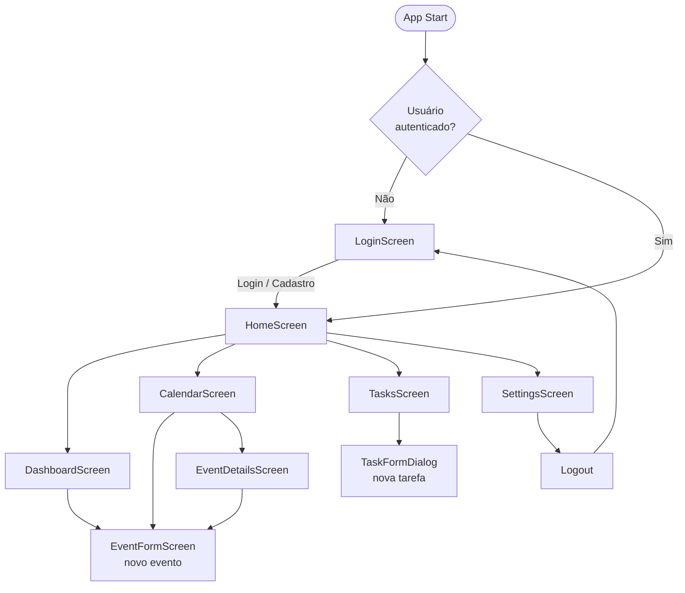
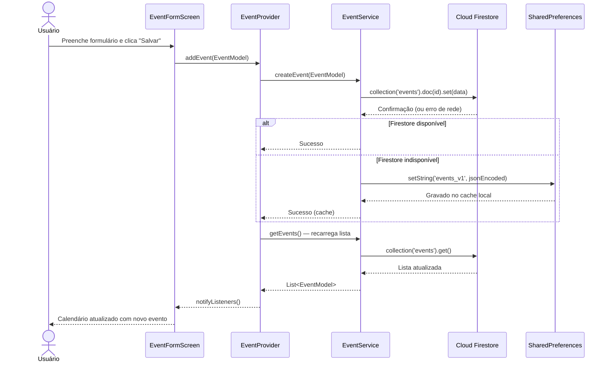
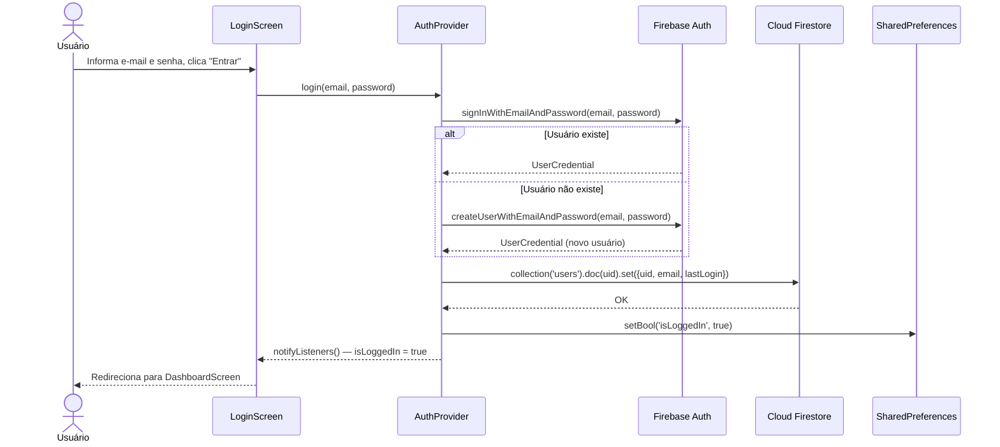

# 02 — Arquitetura

## 1. Visão Geral

O Agendify segue a arquitetura **Feature-First** com gerenciamento de estado via **Provider** (padrão ChangeNotifier). A separação de responsabilidades é organizada em camadas:

| Camada          | Responsabilidade                                                      | Localização               |
|-----------------|-----------------------------------------------------------------------|---------------------------|
| **UI (Screens)**| Renderizar dados e capturar ações do usuário                          | `lib/features/*/screens/` |
| **State**       | Manter e notificar estado da aplicação (ChangeNotifier)              | `lib/core/providers/`     |
| **Services**    | Comunicar com Firestore e SharedPreferences (I/O)                     | `lib/services/`           |
| **Models**      | Estruturas de dados puras com `toJson`/`fromJson`                     | `lib/models/`             |
| **Core**        | Tema, rotas, cores e widgets reutilizáveis                            | `lib/core/`               |

### Paleta da Marca

| Token       | Hex       | Uso                            |
|-------------|-----------|--------------------------------|
| Primary     | `#185286` | AppBar, botões principais      |
| Secondary   | `#2CB5C4` | Destaques, ícones ativos       |
| Background  | `#121212` | Fundo geral (dark theme)       |
| Surface     | `#1E1E1E` | Cards e painéis                |

---

## 2. Fluxo de Navegação entre Telas



---

## 3. Diagrama de Sequência — Criação de Evento

Fluxo completo desde o clique do usuário até a confirmação de persistência no Firestore:



---

## 4. Diagrama de Sequência — Login / Autenticação



---

## 5. Estrutura de Dados no Firestore

```
Firestore/
├── users/
│   └── {uid}/
│       ├── uid: String
│       ├── email: String
│       ├── username: String
│       └── lastLogin: Timestamp
│
├── events/
│   └── {eventId}/
│       ├── id: String (UUID)
│       ├── title: String
│       ├── start: String (ISO 8601)
│       ├── end: String (ISO 8601)
│       ├── description: String?
│       ├── location: String?
│       ├── category: String?
│       ├── notes: String?
│       └── isRecurring: Boolean
│
└── tasks/
    └── {taskId}/
        ├── id: String (UUID)
        ├── title: String
        ├── deadline: String? (ISO 8601)
        └── isCompleted: Boolean
```
