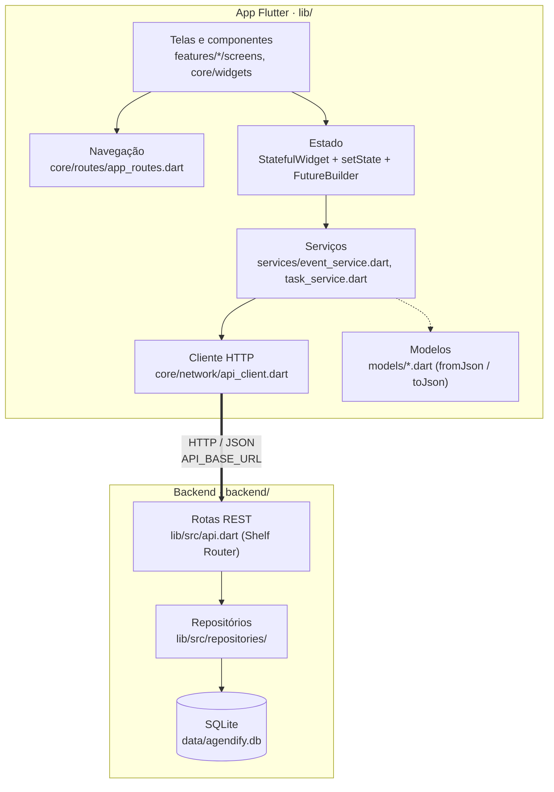
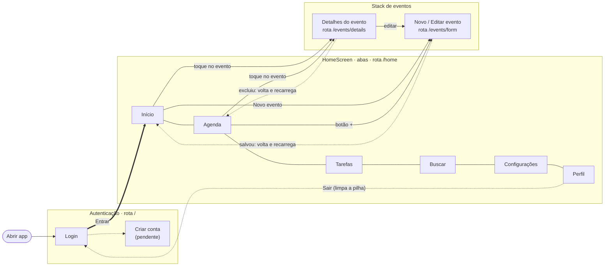
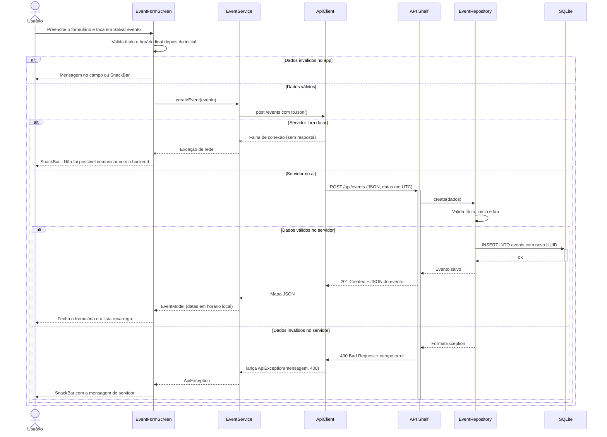
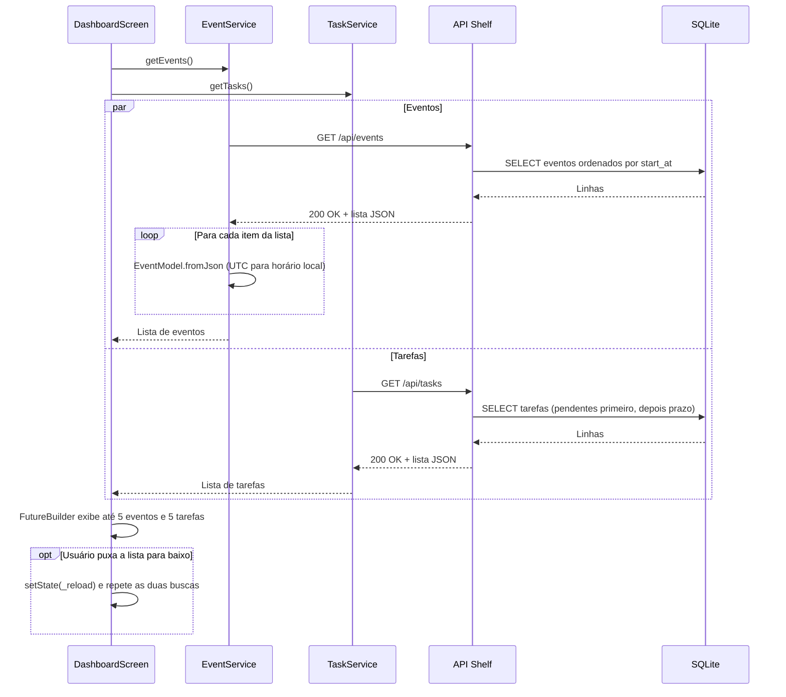
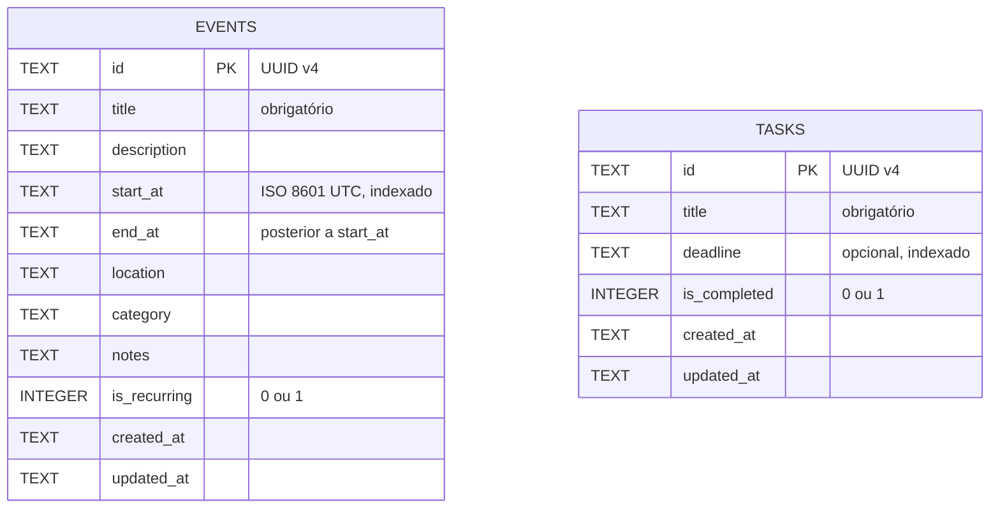

# 02 · Arquitetura

[← Visão e requisitos](01-visao-e-requisitos.md) · **Arquitetura** · [Planejamento →](03-planejamento.md)

Este documento responde a uma pergunta: **onde eu mexo para alterar isto?**

## 1. Visão geral em camadas

O projeto tem duas partes no mesmo repositório: o **aplicativo Flutter** (`lib/`) e a **API REST em Dart** (`backend/`). Cada camada só conversa com a vizinha: a tela nunca monta requisição HTTP, e a API nunca escreve SQL fora dos repositórios.

| Camada | Onde fica | Responsabilidade |
|---|---|---|
| Telas e componentes | `lib/features/<funcionalidade>/screens/`, `lib/core/widgets/` | Desenhar a interface, validar formulário e mostrar erros. |
| Navegação | `lib/core/routes/app_routes.dart`, `lib/features/home/screens/home_screen.dart` | Rotas nomeadas (`/`, `/home`, `/events/form`, `/events/details`) e troca de abas da Home. |
| Estado | Dentro de cada tela (`State`) e em `lib/app.dart` | Guardar o `Future` da lista e recarregar com `setState`. O tema (claro/escuro) é o único estado global e fica em `AgendifyApp`. |
| Serviços | `lib/services/` | Traduzir operações da tela (`createEvent`, `getTasks`...) em chamadas à API e converter JSON em modelo. |
| Rede | `lib/core/network/`, `lib/core/config/api_config.dart` | Montar a URL, enviar JSON, transformar resposta de erro em `ApiException`. |
| Rotas REST | `backend/lib/src/api.dart`, `backend/bin/server.dart` | Receber a requisição, aplicar CORS e log, devolver o código HTTP certo. |
| Persistência | `backend/lib/src/repositories/`, `backend/lib/src/database/app_database.dart` | Validar dados, gerar UUID e executar SQL. Criar as tabelas na primeira execução. |

Não existe armazenamento local no aparelho: todo dado vem da API. Os serviços `AuthService`, `NotificationService` e `CalendarSyncService` e o arquivo `lib/data/mock_data.dart` existem, mas ainda não são usados por nenhuma tela.

### Onde eu mexo para...

| Quero... | Arquivo |
|---|---|
| Mudar o endereço da API | `.env` (`API_BASE_URL`), lido por `lib/core/config/api_config.dart` |
| Criar uma tela nova com rota própria | `lib/features/<nome>/screens/` e registrar em `lib/core/routes/app_routes.dart` |
| Criar uma aba nova | listas `pages` e `destinations` (e `NavigationRailDestination`) em `home_screen.dart` |
| Adicionar um campo ao evento | `lib/models/event_model.dart`, `event_form_screen.dart`, `backend/lib/src/repositories/event_repository.dart` e a tabela em `app_database.dart` |
| Criar um endpoint | `backend/lib/src/api.dart` + método no repositório |
| Mudar cores e tema | `lib/core/constants/app_colors.dart`, `lib/core/theme/app_theme.dart` |

## 2. Mapa de navegação

O app abre no login. O login substitui a tela (`pushReplacementNamed`), então Voltar não retorna a ele. A Home é um conjunto de seis abas que vivem na mesma tela; formulário e detalhes de evento são rotas empilhadas por cima. As telas de evento devolvem `true` ao fechar quando algo mudou, e quem abriu recarrega a lista.

Em telas com **900 px ou mais** de largura, as mesmas seis abas aparecem em um menu lateral (`NavigationRail`) em vez da barra inferior. Os resultados da aba Buscar ainda não abrem os detalhes do evento.

## 3. Diagramas de sequência

### 3.1 Criar um evento

Fluxo completo do RF03, da tela até o banco, com os três desfechos possíveis: validação local, erro do servidor (400) e servidor fora do ar.

### 3.2 Carregar a tela Início

A tela dispara as duas buscas ao mesmo tempo, e cada `FutureBuilder` mostra carregando, erro, lista vazia ou até cinco itens.

## 4. Modelo de dados

Duas tabelas independentes, criadas por `AppDatabase._migrate()`. Datas são texto ISO 8601 em UTC; booleanos são `INTEGER` 0/1. Ainda não há coluna de usuário (entra com o RF13).

As rotas da API (`GET/POST /api/events`, `GET/PUT/DELETE /api/events/:id`, o mesmo para `/api/tasks`, e `GET /health`) estão detalhadas em [backend/README.md](../backend/README.md).

## 5. Papel das bibliotecas

| Biblioteca | Onde | Papel no projeto |
|---|---|---|
| Flutter (Material 3) | App | Toda a interface: `NavigationBar`/`NavigationRail` na Home, `CalendarDatePicker` na Agenda, `showDatePicker`/`showTimePicker` no formulário, `SnackBar` para erros, tema claro e escuro com `ColorScheme.fromSeed`. |
| `Navigator` (Flutter) | App | Navegação por rotas nomeadas em `AppRoutes.onGenerateRoute`, passando o `EventModel` como argumento e recebendo `true` de volta quando a lista precisa recarregar. |
| `http` | App | Único ponto de saída de rede, encapsulado em `ApiClient`. Recebe um `http.Client` opcional no construtor, o que permite trocar por um cliente falso nos testes. |
| `cupertino_icons` | App | Fonte de ícones do estilo iOS (dependência padrão do template). |
| `flutter_test` | App | Teste de widget em `test/widget_test.dart`, que confere se o app abre no login. |
| `flutter_lints` | App | Regras de análise estática; o projeto acrescenta `prefer_single_quotes`. |
| `shelf` | Backend | Servidor HTTP e o `Pipeline` com os middlewares de log (`logRequests`) e de CORS, necessário para o app rodando no navegador. |
| `shelf_router` | Backend | Associa método e caminho (`/api/events/<id>`) à função que atende a requisição. |
| `sqlite3` | Backend | Abre o arquivo do banco, cria tabelas e índices e executa SQL com parâmetros (`?`), o que evita injeção de SQL. Liga `foreign_keys` e o modo `WAL`. |
| `uuid` | Backend | Gera o `id` (UUID v4) de cada evento e tarefa no servidor. |
| `lints` / `test` | Backend | Análise estática e base para testes do backend (ainda sem testes escritos). |

Não há biblioteca de gerenciamento de estado (Provider, Riverpod, Bloc) nem de armazenamento local (`shared_preferences`, `sqflite`). Se o app ganhar modo offline ou tema salvo, é nessas duas categorias que as novas dependências vão entrar.
