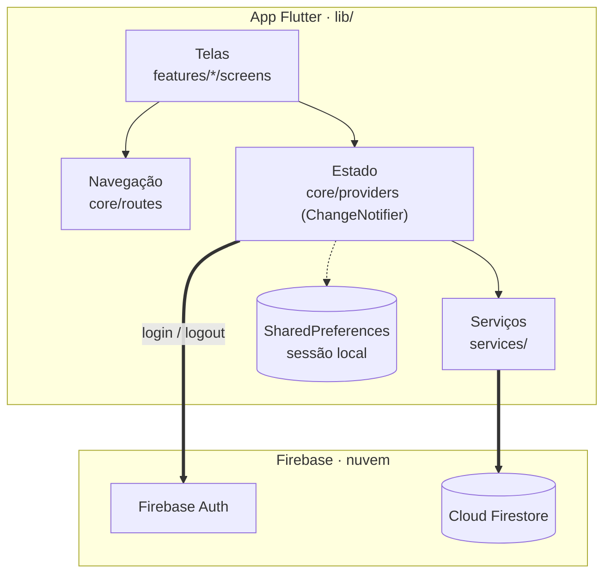
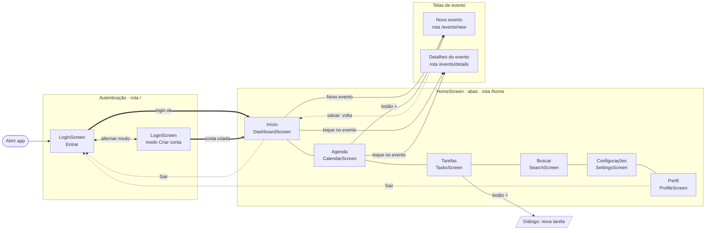
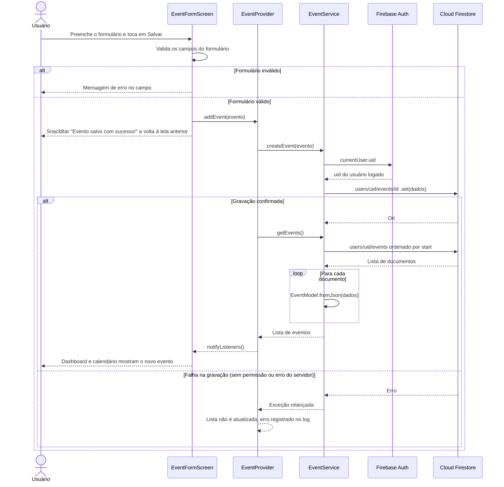
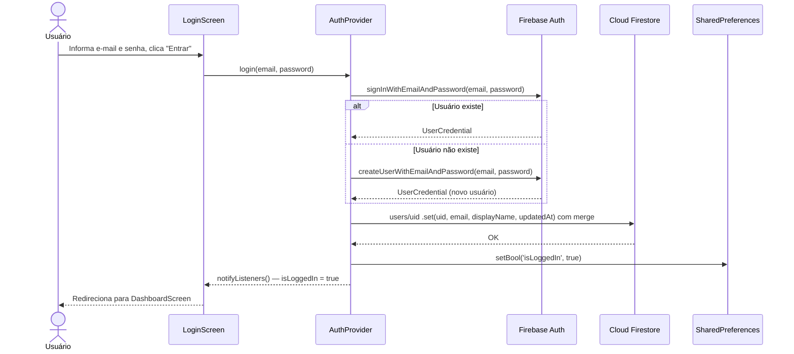

# 02 — Arquitetura

[← Visão e requisitos](01-visao-e-requisitos.md) · **Arquitetura** · [Planejamento →](03-planejamento.md)

## 1. Visão Geral

O Agendify segue a arquitetura **Feature-First** com gerenciamento de estado via **Provider** (padrão ChangeNotifier). A separação de responsabilidades é organizada em camadas:

| Camada          | Responsabilidade                                                      | Localização               |
|-----------------|-----------------------------------------------------------------------|---------------------------|
| **UI (Screens)**| Renderizar dados e capturar ações do usuário                          | `lib/features/*/screens/` |
| **State**       | Manter e notificar estado da aplicação (ChangeNotifier)              | `lib/core/providers/`     |
| **Services**    | Comunicar com Firestore e SharedPreferences (I/O)                     | `lib/services/`           |
| **Models**      | Estruturas de dados puras com `toJson`/`fromJson`                     | `lib/models/`             |
| **Navegação**   | Rotas nomeadas (`/`, `/home`, `/events/new`, `/events/details`) e abas da Home | `lib/core/routes/app_routes.dart`, `lib/features/home/screens/home_screen.dart` |
| **Persistência**| Dados na nuvem (Cloud Firestore) e sessão no dispositivo (SharedPreferences) | `lib/services/`, `lib/core/providers/auth_provider.dart` |
| **Core**        | Tema, cores e widgets reutilizáveis                                   | `lib/core/`               |

Cada camada só conversa com a vizinha: as telas leem e alteram dados pelos Providers, os Providers chamam os Services, e só os Services acessam o Firestore.



### Paleta da Marca

| Token       | Hex       | Uso                            |
|-------------|-----------|--------------------------------|
| Primary     | `#185286` | AppBar, botões principais      |
| Secondary   | `#2CB5C4` | Destaques, ícones ativos       |
| Background  | `#121212` | Fundo geral (dark theme)       |
| Surface     | `#1E1E1E` | Cards e painéis                |

---

## 2. Fluxo de Navegação entre Telas

O app sempre abre na tela de login. Após entrar, a `HomeScreen` mostra seis abas; formulário e detalhes de evento são rotas empilhadas por cima. O logout pode ser feito pelo Dashboard ou pelo Perfil, e limpa a pilha de telas.



Em telas com 900 px ou mais de largura, as mesmas abas aparecem em um menu lateral (`NavigationRail`) em vez da barra inferior.

---

## 3. Diagrama de Sequência — Criação de Evento

Fluxo desde o toque em "Salvar" até a gravação no Firestore. O formulário fecha logo após o envio; a gravação e a atualização da lista acontecem em seguida, pelo Provider.



> Sem conexão, o Firestore SDK guarda a escrita no cache local e a envia quando a rede volta (no Android e no iOS por padrão).

---

## 4. Diagrama de Sequência — Login / Autenticação



---

## 5. Estrutura de Dados no Firestore

Todos os dados ficam sob o documento do usuário, o que separa os dados de cada conta:

```text
Firestore/
└── users/
    └── {uid}/
        ├── uid: String
        ├── email: String
        ├── displayName: String
        ├── photoUrl: String?
        ├── updatedAt: Timestamp
        │
        ├── events/                 (subcoleção)
        │   └── {eventId}/
        │       ├── id: String (UUID)
        │       ├── title: String
        │       ├── start: String (ISO 8601)
        │       ├── end: String (ISO 8601)
        │       ├── description: String?
        │       ├── location: String?
        │       ├── category: String?
        │       ├── notes: String?
        │       └── isRecurring: Boolean
        │
        ├── tasks/                  (subcoleção)
        │   └── {taskId}/
        │       ├── id: String (UUID)
        │       ├── title: String
        │       ├── deadline: String? (ISO 8601)
        │       └── isCompleted: Boolean
        │
        └── categories/             (subcoleção, criada com os padrões no 1º acesso)
            └── {categoryId}/       (work, personal, health, study)
                ├── id: String
                ├── name: String
                └── colorValue: int (cor ARGB)
```

---

## 6. Papel das Bibliotecas

| Biblioteca | Papel no projeto |
|---|---|
| `firebase_core` | Inicializa a conexão com o projeto Firebase em `main.dart`, usando `firebase_options.dart`. Todas as outras bibliotecas Firebase dependem dela. |
| `firebase_auth` | Cadastro e login com e-mail e senha, sessão do usuário e logout (`AuthProvider`). Fornece o `uid` que separa os dados de cada conta. |
| `cloud_firestore` | Banco de dados em nuvem: leitura e escrita de perfil, eventos, tarefas e categorias nos Services. Também oferece cache offline e fila de escritas. |
| `provider` | Gerenciamento de estado: `MultiProvider` em `main.dart` disponibiliza `AuthProvider`, `EventProvider`, `TaskProvider` e `CategoryProvider` às telas, que se redesenham com `notifyListeners()`. |
| `table_calendar` | Calendário mensal da tela Agenda, com marcação dos dias que têm eventos (`eventLoader`). |
| `shared_preferences` | Guarda no dispositivo o indicador de sessão, o nome e o e-mail do usuário, e apaga tudo no logout. |
| `intl` | Declarada para formatar datas em português (pt-BR); ainda não é usada pelo código atual. |
| `uuid` | Gera o `id` de eventos e tarefas no próprio app, antes de gravar no Firestore. |
| `cupertino_icons` | Ícones no estilo iOS. |
| `flutter_lints` (dev) | Regras de análise estática usadas por `flutter analyze`. |
