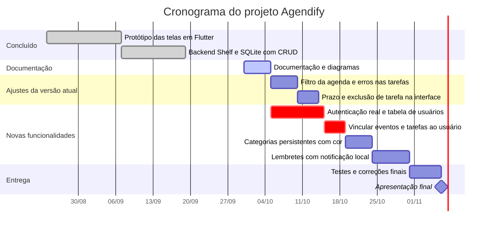
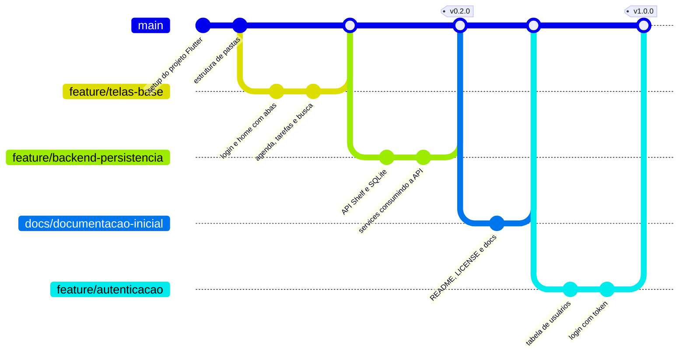

# 03 · Planejamento

[← Arquitetura](02-arquitetura.md) · **Planejamento** · [README ↑](../README.md)

## 1. Cronograma

O cronograma usa `after`: cada tarefa começa quando a anterior termina, então atrasar uma empurra as seguintes no desenho, sem recalcular datas à mão. As datas de 2026 abaixo são **estimativas** a partir da documentação; ajuste a data da apresentação final ao calendário da disciplina.



As tarefas marcadas com `crit` formam o caminho crítico: sem autenticação e vínculo ao usuário, os dados ficam abertos a qualquer um na rede (ver RNF05 em [01-visao-e-requisitos.md](01-visao-e-requisitos.md)).

## 2. Estratégia de branches

O grupo usa um fluxo simples, com uma única branch principal:

- **`main`** é a branch principal: guarda o código integrado e funcionando. Toda branch nova nasce dela. Cada entrega recebe uma tag de versão (`v0.2.0`, `v1.0.0`) igual à `version` do `pubspec.yaml`.
- **`feature/<nome>`**, **`fix/<nome>`** e **`docs/<nome>`** nascem da `main`, tratam de uma coisa só e voltam por **pull request** com revisão de pelo menos um colega. Depois do merge, a branch é apagada.
- Ninguém commita direto na `main`: tudo entra por pull request.

O diagrama mostra o histórico até aqui e o próximo passo planejado:



## 3. Convenção de commits

As mensagens seguem [Conventional Commits](https://www.conventionalcommits.org/pt-br/v1.0.0/), no formato:

```text
<tipo>(<escopo opcional>): <descrição no imperativo, em minúsculas, sem ponto final>
```

| Tipo | Quando usar | Exemplo no Agendify |
|---|---|---|
| `feat:` | Funcionalidade nova para o usuário | `feat(tarefas): permitir definir prazo ao criar tarefa` |
| `fix:` | Correção de bug | `fix(agenda): filtrar eventos pelo dia selecionado` |
| `docs:` | Só documentação | `docs: estrutura inicial de documentação` |
| `refactor:` | Mudança de código sem alterar comportamento | `refactor(api): extrair validação de evento para método próprio` |
| `test:` | Testes novos ou corrigidos | `test(event-service): cobrir resposta 400 da API` |
| `style:` | Formatação, sem mudança de lógica | `style: aplicar dart format` |
| `chore:` | Configuração, dependências, build | `chore: versionar pubspec.lock` |

Escopos sugeridos: `auth`, `home`, `agenda`, `eventos`, `tarefas`, `busca`, `config`, `perfil`, `api`, `db`.

Regras do grupo:

- Um commit, uma mudança. Se a mensagem precisa de "e", provavelmente são dois commits.
- Mudança de comportamento e a atualização do documento que o descreve vão no **mesmo commit** ou no mesmo pull request (Definition of Done: código escrito, teste passando, documento atualizado).
- Mudança que quebra compatibilidade da API recebe `!` depois do tipo e o rodapé `BREAKING CHANGE:`, por exemplo `feat(api)!: exigir token em todas as rotas`.

## 4. Licença

O projeto usa a **licença MIT** (arquivo [LICENSE](../LICENSE)).

**Por que MIT:** é a licença permissiva mais curta e conhecida. Ela deixa qualquer pessoa usar, estudar, alterar e reaproveitar o código, inclusive colegas de outras turmas, exigindo apenas que o aviso de copyright e o texto da licença sigam junto. Isso combina com um trabalho acadêmico que serve de exemplo e de base para evolução, e é a mesma licença usada pelo Flutter e pela maioria das bibliotecas do ecossistema Dart (as do projeto usam BSD-3-Clause ou MIT, todas compatíveis).

**Por que não as outras:** a Apache 2.0 acrescentaria concessão explícita de patente e a obrigação de declarar arquivos alterados, algo desnecessário para o porte do projeto. A GPL obrigaria quem redistribuir uma versão modificada a abrir o código sob a mesma licença, o que restringe reaproveitamento em projetos fechados, e o grupo prefere não impor isso. Ficar **sem** licença deixaria o repositório público, mas com todos os direitos reservados, impedindo legalmente qualquer reuso.
