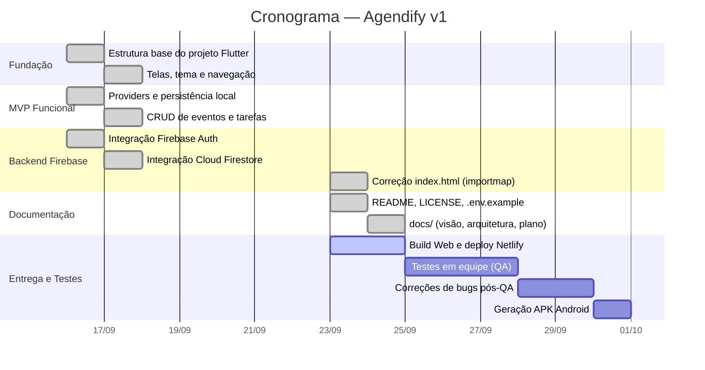
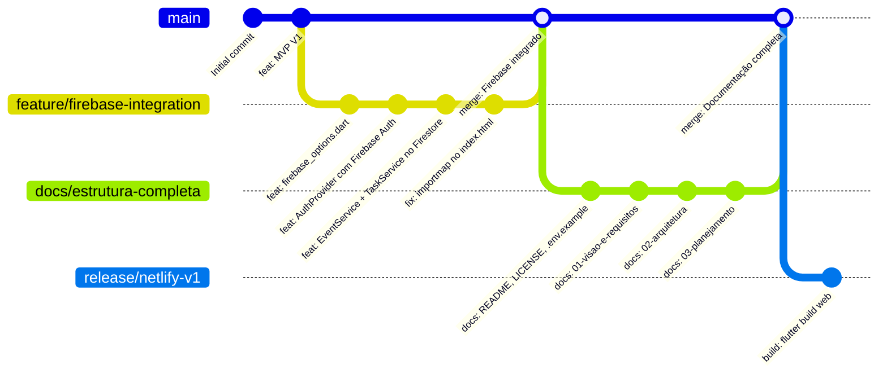

# 03 — Planejamento

## 1. Cronograma do Projeto



---

## 2. Estratégia de Branches

O projeto adota o modelo **GitHub Flow** (simplificado), adequado para equipes pequenas:



### Regras de Branch

| Branch             | Propósito                                                           |
|--------------------|---------------------------------------------------------------------|
| `main`             | Código estável, sempre deployável. Merge somente via Pull Request.  |
| `feature/<nome>`   | Nova funcionalidade. Ex: `feature/notificacoes-push`               |
| `fix/<nome>`       | Correção de bug. Ex: `fix/logo-quebrada-netlify`                   |
| `docs/<nome>`      | Atualização de documentação pura.                                  |
| `release/<versao>` | Preparação de release. Ex: `release/v1.0.0`                        |

---

## 3. Convenção de Mensagens de Commit

O projeto segue o padrão **Conventional Commits** ([spec](https://www.conventionalcommits.org)):

```
<tipo>(<escopo opcional>): <descrição curta em minúsculas>

[corpo opcional — explica o "por quê", não o "o quê"]

[rodapé opcional — ex: BREAKING CHANGE, Closes #123]
```

### Tipos Permitidos

| Tipo       | Quando usar                                                   |
|------------|---------------------------------------------------------------|
| `feat`     | Nova funcionalidade para o usuário                           |
| `fix`      | Correção de bug que afeta o usuário                          |
| `docs`     | Alteração exclusiva em documentação                          |
| `style`    | Formatação, espaços, ponto-e-vírgula (sem lógica)           |
| `refactor` | Refatoração de código sem mudar comportamento                |
| `test`     | Adição ou correção de testes                                 |
| `build`    | Mudanças no build system ou dependências (pubspec, gradle)   |
| `chore`    | Tarefas de manutenção que não afetam produção                |

### Exemplos Corretos

```
feat(auth): adicionar login com google via firebase
fix(calendar): corrigir exibição de eventos em dias com múltiplos fusos
docs(readme): atualizar passo-a-passo de como rodar do zero
build(pubspec): adicionar cloud_firestore 6.10.0
refactor(event_service): extrair lógica de cache para método privado
```

### Exemplos Incorretos ❌

```
update                          # sem tipo e sem descrição
fix bug                         # sem escopo e vago
feat: Added new feature         # capitalizado e em inglês desnecessário
```

---

## 4. Definition of Done (Critério de Conclusão)

Uma tarefa só está **concluída** quando **todos** os itens abaixo estão marcados:

- [ ] O código foi implementado e está funcional.
- [ ] `flutter analyze` retorna **0 erros e 0 warnings**.
- [ ] O comportamento foi testado manualmente (Web + Android quando aplicável).
- [ ] A documentação relevante em `docs/` foi atualizada no **mesmo commit**.
- [ ] O `CONTEXTO.md` foi atualizado se houve mudança de arquitetura, dependência ou comando.
- [ ] O commit segue a convenção **Conventional Commits**.
- [ ] O Pull Request foi revisado por pelo menos **1 membro da equipe** antes do merge em `main`.
